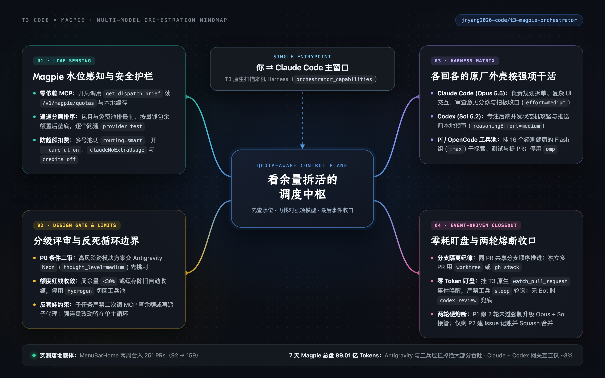

# T3 Code × Magpie Multi-Model Orchestrator Skills

> [简体中文](README.md) · English



Single-entry, quota-aware multi-model engineering workflow for **[T3 Code](https://t3.codes)** + **[Magpie](https://github.com/yetone/magpie)**.

Keep **one flagship agent** (e.g. Claude Code / Opus) as your sole conversation interface while automatically:
- Checking **live subscription & plan remaining quotas** across Magpie (`/v1/magpie/quotas`) and local T3 caches (e.g. Antigravity weekly usage) before delegating;
- Routing tasks to **native harnesses** matched to each model's strengths (Claude Code for orchestration & complex UI, Codex for core backend & adversarial review, Pi / OpenCode backed by a tested Magpie Flash bundle for exploration, tests, implementation slices, and PR chores);
- Gating high-risk P0 designs through an optional second-opinion reviewer;
- Watching opened PRs at **zero LLM token cost** via T3's built-in `watch_pull_request`, with local `codex review` fallback, a **2-round fix circuit breaker**, substantive-only P2 tracking issues, and clean PR closeout.

---

## Included Skills

1. **[`setup-t3-orchestrator-workflow`](skills/setup-t3-orchestrator-workflow/SKILL.md)** *(run once / on demand, `disable-model-invocation: true`)*
   - Inspects your actual installed tools (`magpie`, T3 Code caches, `claude`, `codex`, `pi`, `opencode`, `gh`).
   - Tests candidate low-cost Flash models (`magpie provider test`) to drop broken 400/404 endpoints before creating your `group/flash-worker`.
   - Orders fixed subscription/free pools ahead of cash-balance providers.
   - Guides safe multi-account Magpie hygiene (`routing=smart`, `--careful on`, credit/overage guards) and generates your local `~/.config/t3-orchestrator/roster.json`.
   - Registers the bundled read-only **`magpie-dispatch` MCP server** (`get_dispatch_brief`).

2. **[`t3-orchestrator-workflow`](skills/t3-orchestrator-workflow/SKILL.md)** *(runtime workflow)*
   - Enforces check-quota-first orchestration, subagent anti-loop guardrails, P0 critique gating, single-PR vs. `worktree`/`gh stack` rules, pre-push high-risk review, `watch_pull_request` wakeup triage, 2-round fix escalation, and P2 issue hygiene.

---

## Prerequisites

- **[T3 Code](https://t3.codes)** (with `orchestrator_capabilities`, `delegate_task`, `watch_pull_request`)
- **[Magpie](https://github.com/yetone/magpie)** running locally (`GET http://127.0.0.1:3425/v1/magpie/quotas` or custom port read from `~/.config/magpie/gateway.json`)
- **Python 3.9+** (standard library only; zero external `pip` dependencies for `dispatch_mcp.py`)
- At least one primary agent CLI (`claude` / `codex`) and optional worker CLIs (`pi`, `opencode`), plus `gh` for PR automation.

---

## Quick Start

### 1. Install the Skills

```bash
npx skills add jryang2026-code/t3-magpie-orchestrator
```

*(Or clone `https://github.com/jryang2026-code/t3-magpie-orchestrator` and symlink `skills/setup-t3-orchestrator-workflow` and `skills/t3-orchestrator-workflow` into your agent skills directory.)*

### 2. Run Interactive Setup Inside Your Agent

Open a session (Claude Code / Codex / Antigravity) and run:

```text
/setup-t3-orchestrator-workflow
```

The setup skill probes your active subscriptions, verifies which models actually respond, creates your `~/.config/t3-orchestrator/roster.json`, and registers `skills/t3-orchestrator-workflow/scripts/dispatch_mcp.py` as the `magpie-dispatch` MCP server (including `--exposure direct` for Pi).

### 3. Use in T3 Code

Open a **new thread** in T3 Code on your orchestrator harness and talk only to that thread:

```text
/t3-orchestrator-workflow Implement feature X, run full checks, open a PR, and watch reviews until merge-ready.
```

---

## Bundled MCP Smoke Test

You can inspect what the MCP returns on your machine at any time without starting an agent:

```bash
python3 skills/t3-orchestrator-workflow/scripts/dispatch_mcp.py --cli
```

It reads:
1. Live Magpie quotas from `~/.config/magpie/gateway.json` (or `MAGPIE_QUOTAS_URL`)
2. Optional T3 Antigravity limits from `~/.t3/caches/antigravity.json` (including cache staleness detection)
3. Your customized `~/.config/t3-orchestrator/roster.json` (falling back to `references/roster.example.json`)

---

## License

MIT
