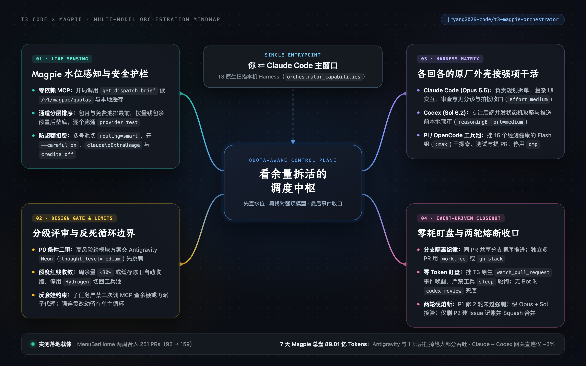
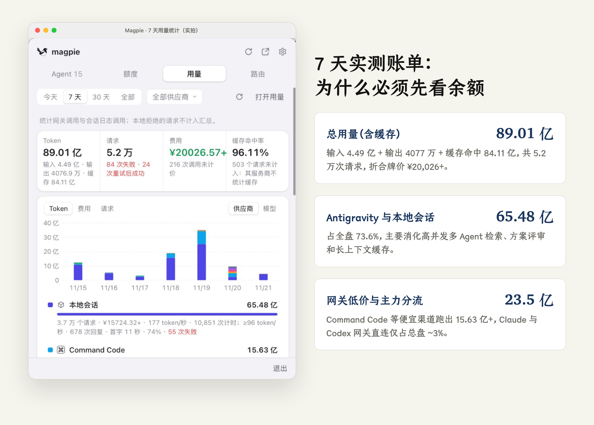
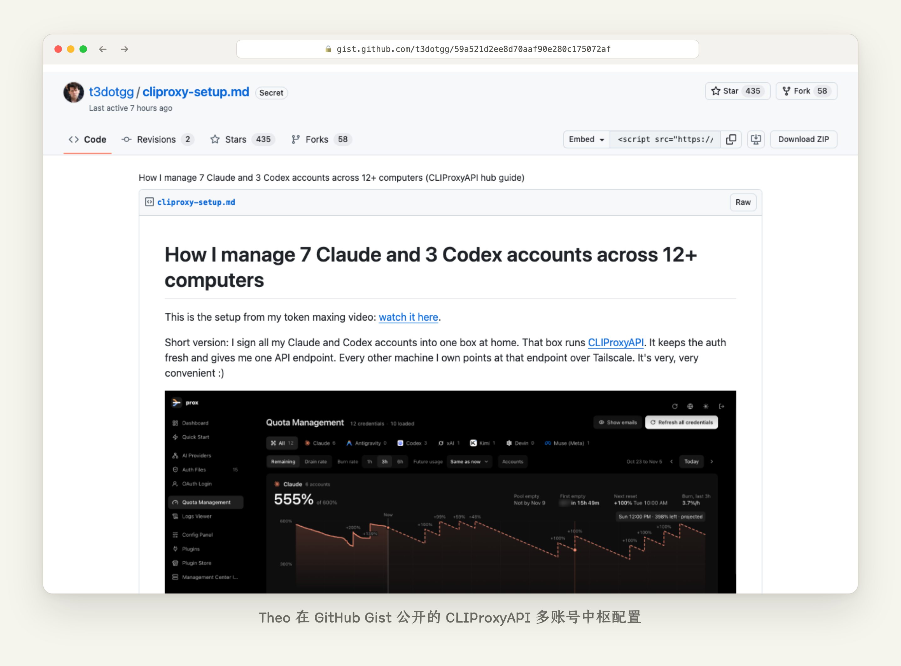
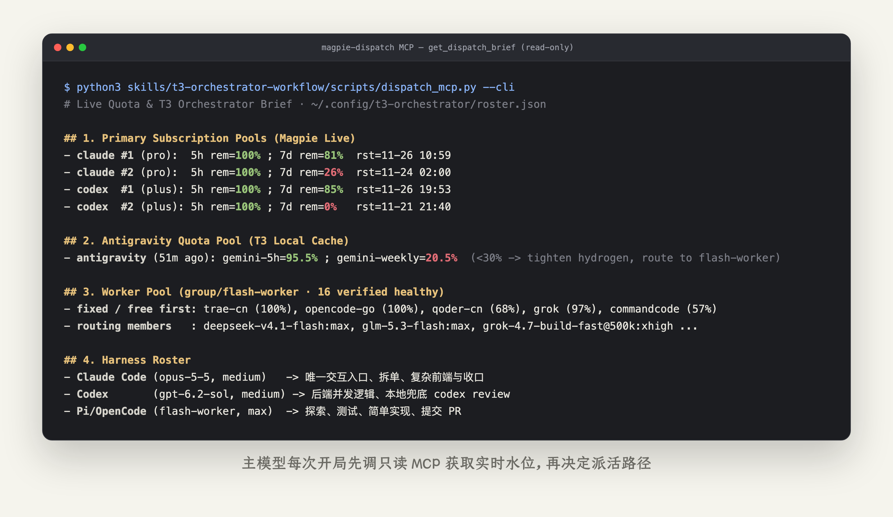
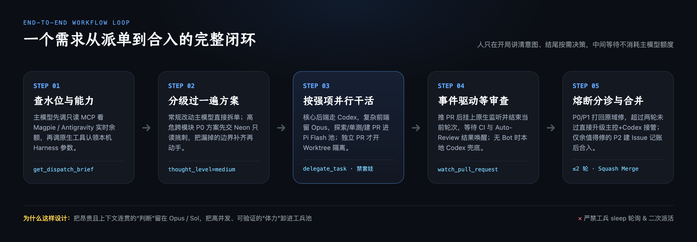

# T3 Code × Magpie 多模型协同工作流

> 简体中文 · [English](README.en.md)

**只和 T3 Code 里的一个主力对话窗口说话，让它自己先看一眼实时余额，再把任务拆给最顺手的模型、用最合适的原厂 Harness 去干。**



---

## 一、前因：不是模型不够强，是全靠手切根本跑不动

刷评测刷久了，很容易像集邮一样开一圈订阅：Claude Pro、Codex Plus、Antigravity，再加上几个送额度或者包月的轻量 Flash 渠道。

各自用了一段时间后，脾气其实都很清楚。Claude Opus 5.5 适合拿主意、搭复杂界面和最后收口；Codex Sol 6.2 啃后端并发逻辑、状态机排障和挑代码毛病更细；至于全仓检索、跑测试、提交 PR 这些重复体力活，让 Pi 或 OpenCode 挂上一批 Flash 模型跑，又快又不心疼。

最早我试过 Paseo 给不同 Agent 分角色，后来换到 **[T3 Code](https://t3.codes)**。T3 Code 最打动我的一点，是它原生就能扫描你本机装了哪些 Harness 和 CLI——不管你装了 Claude Code、Codex、Pi、OpenCode 还是 Antigravity，主模型调一下内置的 `orchestrator_capabilities` 就能全部认全，并不需要人去手工报菜名。

**但真拿它高强度推实际项目时，还是有两个卡点：**

1. **它看得到本机有哪些工具，却不知道你的派活规矩**：虽然本地十来个工具都连着，但我其实只想在主窗口和 Claude 对话，要求“后端硬活走 Codex、高风险设计先过一遍 Neon、本地装了 `omp` 但不要用它”。每次新开线程，这套职责和禁忌还得靠人重贴一遍。
2. **主模型看不见 Magpie 里的实时剩余配额**：T3 Code 自己只存了部分本地工具的基础状态，不知道我多个 Claude / Codex 账号池里还剩多少 5 小时或 7 天额度，更分不清哪些渠道是包月、哪些在烧按量钱包。跑着跑着主力账号突然撞限停摆，旁边几乎没动过的 Flash 额度却一直闲着。



拉出本地 Magpie 的 7 天消耗面板更能看清这种压力：一周下来共产生 **89.01 亿 Token（含 84.11 亿缓存读取，输入 4.49 亿、输出 4076.9 万）**、**5.2 万次请求**，按 API 牌价折合超过 **¥20,026+**。到这个吞吐量级，靠人眼盯着几个窗口手动切账号、猜剩余额度，效率迟早崩掉。

---

## 二、思考与取舍：我们考虑了什么，又有哪些明确限制

### 1. 为什么用 Magpie + 只读 MCP，而不另起一套代理？

动工前我翻过 Theo 公开在 GitHub Gist 上的做法——他用 CLIProxyAPI（CPA）把家里十几台机器要用的 Claude 和 Codex 账号集中到一个端点再走 Tailscale 分发。



但就我日常都在用 **[Magpie](https://github.com/yetone/magpie)** 的习惯来说，没必要为了调度再叠一层新网关。Magpie 本身就已经在抓各家订阅的 5 小时和 7 天即时水位，还能把多个便宜渠道捆成一个 `Model Group` 自动兜底。既然网关里已经有实时配额，我干脆写了一个不带任何第三方依赖的本地只读 MCP（`skills/t3-orchestrator-workflow/scripts/dispatch_mcp.py`），让主模型开局先调一次 `get_dispatch_brief` 把可用水位看一眼：



### 2. 为什么坚持“单一对话入口”，不搞一堆 Bot 互相聊？

用过几轮多 Bot 群聊模式后有个很深的体会，也是 Anthropic 那篇 Single-Agent-Loop 实践里反复提到的事：**Agent 之间每次交接（Handover），本质上都是在压缩摘要，一定伴随细节折损**。

所以这套工作流刻意克制了子代理的权限：
- 连续性强的设计规划、跨模块架构拆解、复杂 UI 交互和最后的 Merge 判断，全部留在 Claude Code（Opus 5.5）这一个主窗口里一气呵成。
- 只有目标清晰、结果可直接靠测试或 Diff 验收的任务（例如只读搜仓、按明确接口补实现、跑测试、提交 PR），才用 `delegate_task` 派出去。

### 3. 为什么不硬编码模型清单，而要先做 `setup` 探测？

每个人的账号池和所在网络都不一样，同一批便宜模型在不同上游今天通、明天挂是常态。做开源仓库时最忌讳把写死的作者清单当默认模板，因此这个仓库拆成了两个 Skill：

- **`setup-t3-orchestrator-workflow`**：安装后先按本机真实环境走一轮体检，逼着在入池前用 `magpie provider test` 筛掉返回 `400` / `404` 的坏接口，强制把**包月/免费额度**排在**按量余额**前面，同时帮你检查多账号护栏（`routing=smart`、`magpie provider pool <id> --careful on`、`claudeNoExtraUsage on`、Codex `magpie quota credits off`），最后把结果写进你本机私有的 `~/.config/t3-orchestrator/roster.json`。
- **`t3-orchestrator-workflow`**：日常运行手册。每次动手前结合实时水位和你的偏好配置拆单，并管住后面的 PR 生命周期。

### 4. 当前刻意保留的设计限制（不承诺做不到的事）

- **不同 Harness 仍有参数和上下文边界**：在 T3 Code `delegate_task` 下，各家推理参数字段并不统一（Claude 用 `effort`，Codex 用 `reasoningEffort`，Antigravity 用 `thought_level`，OpenCode 用 `variant`），需要靠 `orchestrator_capabilities` 实时对齐；另外 `pi mcp add` 默认 `--exposure` 为 `codemode`，若你偶发单独直开 Pi 也想读余额要加 `--exposure direct`，但反过来，所有被 `delegate_task` 派出的子工兵在规则上**禁止二次查余额或二次派活**，宁可保守也不允许套娃。
- **Antigravity 余额依赖本地缓存新鲜度**：读取 `~/.t3/caches/antigravity.json` 时，只要缓存超过阈值会自动标出陈旧警告，避免主模型拿着过期的高余额放量派单；一旦周配额低于 `30%`，自动停用轻任务补位，切换回 Flash 工兵池。
- **需要本地跑通 Magpie 与 T3 Code**：这套方案不是独立的 SaaS 编排平台，而是面向正在桌面端同时使用 T3 Code 和 Magpie 的重度个人开发者；如果你完全没有本地 Harness 或不想开启 Magpie 网关，直接裸用 T3 Code 会更轻。

---

## 三、执行闭环：一单任务从派单到收口怎么跑



平时开发我的开源跨端桌面工具 **[MenuBarHome](https://github.com/jryang2026-code/MenuBarHome)**（一个运行在 macOS Swift 6 和 Windows 11 Tauri v2 菜单栏里的米家与 Home Assistant 控制工具，支持快捷键拼音首字母直搜、本地语音和误关撤销）时，整条流水线基本按上面这五个阶段自动往下推：

1. **查水位与能力**：主模型先拉 `get_dispatch_brief` 摸清当前哪个订阅宽裕，再调 `orchestrator_capabilities` 确认各 Harness 参数。
2. **条件二审**：日常小需求直接拆单动手；遇到高风险或跨模块架构改动（P0），主模型先拟出边界文档，交由 Antigravity Neon（`thought_level=medium`）只读挑刺一遍再进入编码。
3. **分支与派工纪律**：同一个功能的连续开发留在同一分支依次提交；只有相互独立的模块 PR，才启用 `isolation: "worktree"` 隔离并行（有前后依赖则交给 `gh stack`）。
4. **事件唤醒，不瞎轮询**：工兵测通、推分支并建好 PR 后，主线程直接调用 T3 原生 `watch_pull_request` 然后挂起结束当轮，**零 Token 等待 CI 与 GitHub Codex Auto-Review**（若仓库未配置 Bot 或超时，则本地补跑一次 `codex review` 兜底，避免卡死）。
5. **两轮硬熔断收口**：遇到 P0/P1 阻断意见打回原负责域修复；**最多修两轮，两轮过不了强制熔断，升级由 Claude + Codex 联合接管**。确认只剩有保留价值的 P2 建议且 CI 全绿后，建 GitHub Issue 登记（绝不为改个空格建一条水 Issue），再执行 Squash 合并并清场。

拿这套分工模式连轴推进 **[MenuBarHome](https://github.com/jryang2026-code/MenuBarHome)** 的两周里，项目累计合入了 **251 个 PR**（第一周 92 个、第二周 159 个）；在最近 7 天 **89.01 亿** 全量 Token 的真实流量盘子里，绝大部分检索、长上下文缓存和常规试错都留在了 Antigravity 与 Pi / OpenCode 工兵层，昂贵的 **Claude 与 Codex 网关直连只消耗了全盘的 ~3%**，我也不用一直坐在几个终端中间当人工传话筒。

---

## 四、技术落地与安装

### 1. 环境前提

- **[T3 Code](https://t3.codes)**（支持 `orchestrator_capabilities`、`delegate_task`、`watch_pull_request`）
- **[Magpie](https://github.com/yetone/magpie)**（默认监听本地 `http://127.0.0.1:3425`，也支持从 `~/.config/magpie/gateway.json` 自动识别自定义端口）
- **Python 3.9+**（`dispatch_mcp.py` 仅使用标准库，零额外 `pip` 依赖）
- 本地已安装至少一个主控 CLI（`claude` / `codex`）以及你打算当工兵的 CLI（`pi` / `opencode`）与 `gh`

### 2. 安装两个 Skill

```bash
npx skills add jryang2026-code/t3-magpie-orchestrator
```

*(也可以直接 clone 本仓库，将 `skills/setup-t3-orchestrator-workflow` 与 `skills/t3-orchestrator-workflow` 软链到你的全局技能目录。)*

### 3. 首次初始化（根据你自己的订阅生成配置）

打开任意一个 Agent 会话（Claude Code / Codex / Antigravity），执行一次：

```text
/setup-t3-orchestrator-workflow
```

它会先探测你本地的订阅余额和健康模型，和你确认偏好后生成 `~/.config/t3-orchestrator/roster.json`，并自动把 `magpie-dispatch` 只读 MCP 注册进 `claude`、`codex`、`pi`、`opencode`。

想随时人工看一眼当前本机探测出的水位和编排表，在仓库根目录直接跑：

```bash
python3 skills/t3-orchestrator-workflow/scripts/dispatch_mcp.py --cli
```

### 4. 日常在 T3 Code 里使用

在 T3 Code 里为你的总控 Harness 新开一条对话，直接下需求即可：

```text
/t3-orchestrator-workflow 实现功能 X，跑完测试，提 PR 并盯到满足合并条件。
```

### 5. 仓库结构速览

```text
.
├── docs/assets/                                   # 思维导图、闭环图与实测截图素材
├── skills/
│   ├── setup-t3-orchestrator-workflow/
│   │   └── SKILL.md                               # 一次一跑的环境体检、测活与配置生成引导
│   └── t3-orchestrator-workflow/
│       ├── SKILL.md                               # 运行期查水位、二审、派活与两轮熔断手册
│       ├── references/
│       │   └── roster.example.json                # 本机角色与阈值配置示例模板
│       └── scripts/
│           └── dispatch_mcp.py                    # 零依赖只读 MCP 服务（兼 CLI 预览）
├── README.md                                      # 简体中文说明（默认）
├── README.en.md                                   # English README
└── LICENSE                                        # MIT
```

---

## License

MIT
